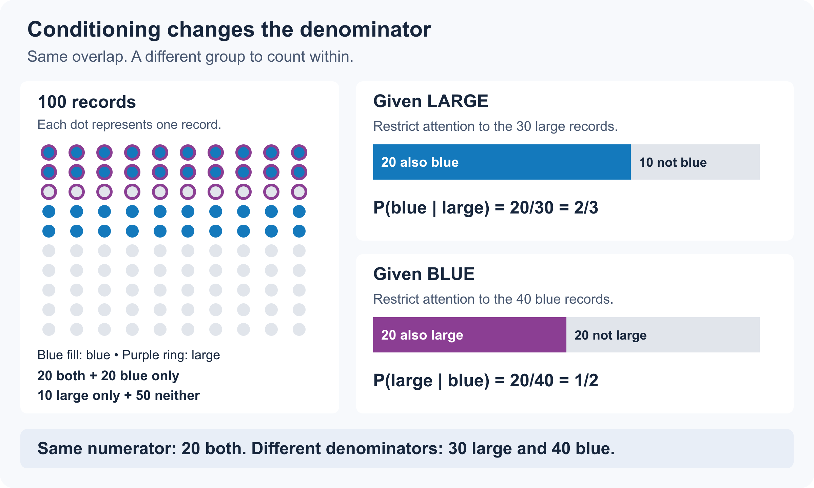

# 01 — Shared foundations for generative AI

[Download as PDF](https://github.com/Naviden/Generative_AI_Course/raw/refs/heads/main/reading-group/pdf/01-foundations.pdf)

[Reading-group home](README.md) · Next: [02 — How generative models work](02-generative-models.md)

## 1. What a generative model does

Suppose we want to generate new records describing objects by their colour and size. One record might say “blue and large”; another might say “not blue and not large”. A useful generator should reproduce how often these combinations occur, including their dependence. Producing one plausible record is easy. Learning how often to produce each kind of record is the modelling problem.

A **generative model** describes a distribution of possible observations and provides a way to draw observations from it. An **observation**, written $`x`$, is one complete item we want to generate. Here it is a colour–size pair; in other applications it could be an image, a point or a sequence of tokens. A **variable** is an attribute that can take different values, such as colour or size. Learning changes the model's distribution using examples; sampling then uses that distribution to produce an output.

### From observed records to a model

Our dataset contains 100 records: 40 are blue, 30 are large and 20 are both. These totals give four mutually exclusive possibilities:

| Complete observation | Count in the dataset | Probability in a frequency-fitted model |
|---|---|---|
| Blue and large | 20 | 0.20 |
| Blue and not large | 20 | 0.20 |
| Not blue and large | 10 | 0.10 |
| Not blue and not large | 50 | 0.50 |

The last column is already a small generative model. Its probabilities are nonnegative and add to one: every generated record must belong to exactly one row. The adjustable probabilities are the model's **parameters**, collectively written $`\theta`$. The notation $`p_\theta(x)`$ means “the probability this parameter choice assigns to observation $`x`$”. For example, this model assigns $`p_\theta(\text{blue and large})=0.20`$. A neural generator uses many weights to determine its distribution instead of storing four probabilities directly, but those weights serve the same role: changing them changes what the model is likely to generate.

The dataset is a finite sample from a **population**, the source of observations we hope to model. Its unknown distribution is written $`p_{\mathrm{data}}`$. Matching these 100 records does not prove that the four fitted probabilities equal the population probabilities. We will need fresh observations to assess that claim.

### What it means to generate from the model

**Sampling** means making a random draw according to the assigned probabilities. One way to sample our table is to draw a number uniformly between zero and one, so equal-length intervals are equally likely. Assign intervals of lengths 0.20, 0.20, 0.10 and 0.50 to the four rows. A draw of 0.34 selects the second row, producing “blue and not large”. The notation $`X\sim p_\theta`$ means that the random observation $`X`$ is drawn this way from the model.

Over many draws, about 20% of generated records should be blue and large; a finite batch need not have exactly those frequencies. Always choosing the most probable row would instead generate “not blue and not large” every time. That rule would discard the variability the model learned.

**Exercise:** use intervals `[0, 0.20)`, `[0.20, 0.40)`, `[0.40, 0.50)` and `[0.50, 1)` in table order. What does a random draw of 0.47 generate, and does drawing again change the model?

**Worked answer:** 0.47 lies in the third interval, so the generated record is “not blue and large”. Drawing again can change the output, but the four probabilities remain fixed. **Sampling changes the observation; learning changes the distribution used to sample it.**

## 2. Joint and conditional probability

Our table is a **joint distribution**: it describes colour and size together. An unconditional request is “generate a record”. A conditional request is “generate a record that is large”. The latter restricts the allowed group before sampling; it does not use the original colour frequencies unchanged.

For events $`A`$ and $`B`$, the notation $`p(A,B)`$ means the probability that both occur, and $`p(A\mid B)`$ means the probability of $`A`$ within the group where $`B`$ holds. Thus $`p(A\mid B)=p(A,B)/p(B)`$, provided $`p(B)>0`$.

**Exercise:** among 100 records, 40 are blue, 30 are large and 20 are both. What is the probability of blue given large, and is it the same as large given blue?

**Worked answer:** restrict the denominator to the known group. The first is `20/30 = 2/3`; the second is `20/40 = 1/2`. Conditioning changes the question. Knowing either answer does not show that size causes colour.

For generation, this means that about two thirds of samples conditioned on “large” should be blue, while about half of samples conditioned on “blue” should be large. The same idea appears in text-to-image generation: a prompt is supplied as context, and the model samples an image conditional on that context.

## 3. How a model learns from examples

The four probabilities in our table were fitted to observed frequencies. Why prefer them to 0.25 for every row? Learning needs a way to compare candidate distributions against the examples. **Likelihood** holds the observed data fixed and asks how probable those data are under each model. For independent records, their probabilities multiply.

**Concrete example:** 50 of our 100 records are neither blue nor large. Suppose the model assigns that outcome only 5% probability. It repeatedly treats an ordinary observation as surprising: half the records receive a probability of just 0.05. This can happen before training, when the initial probabilities do not yet reflect the data; after inadequate training; or when a model learned from a different population where this outcome was rare. Maximum-likelihood learning adjusts the probabilities to make the observed data more probable. In our four-row table, fitting all 100 records gives this category 50% probability, while the other three categories share the remaining 50% according to their observed frequencies. Sampling from the fitted model will therefore produce this category about half the time, instead of about one time in twenty.

**Log-loss** turns this comparison into a quantity to minimize. The natural logarithm turns products into sums without changing which likelihood is largest. Negating it makes larger likelihood correspond to smaller loss. For one observed record, the negative log likelihood (NLL), also called log-loss, is $`-\log p_\theta(x)`$. You can read this as a penalty for how unlikely the model considered that record.

| Probability assigned to the observed outcome | Negative log likelihood | Interpretation |
|---|---|---|
| 0.5 | About 0.6931 | Smaller penalty |
| 0.1 | About 2.3026 | Larger penalty |

Average these penalties over the dataset to compare models. For the 100 records, the equal-probability table has average loss about 1.3863; the fitted table `(0.20, 0.20, 0.10, 0.50)` has about 1.2206. The fitted table explains the collection of records better under this objective. It need not assign a higher probability to every individual record: probability reserved for one outcome is unavailable to another.

The change has a direct effect on generation. The equal-probability table produces a large record with probability `0.25 + 0.25 = 0.50`; the fitted table does so with probability `0.20 + 0.10 = 0.30`, matching the observed proportion. **Learning changes the distribution; subsequent sampling uses that changed distribution.** A neural model adjusts weights instead of four table entries, but the objective still supplies a criterion for choosing those changes. The mechanics of computing the updates are in the optional further reading.

**Exercise:** half the training records are “not blue and not large”. Would assigning probability one to that row be an improvement over the fitted table?

**Worked answer:** it would make the other 50 observed records impossible under the model. Their zero assigned probability gives infinite log-loss. Fitting the distribution means accounting for the different observed outcomes, not always choosing the most common one.

Likelihood is one training principle. Some generative models use other objectives because computing observation probabilities directly is difficult. When comparing them, we still need to ask what their loss measures and how learning changes the outputs they generate.

## 4. How to judge a generator

A lower training loss establishes a better fit to that training objective. Two further questions remain: does that fit transfer to fresh observations, and does the sampling procedure produce the intended variety of outputs?

### Training fit and fresh observations

The probability table was fitted using the same observations on which its training loss was measured. A generator intended for new records must also assign sensible probabilities to observations it did not train on. This is why held-out evaluation belongs in the learning argument: it tests whether fitting the observed frequencies taught a distribution that transfers beyond those particular records.

Training observations determine parameter updates. Validation observations help choose between candidate models or settings. A final test set is reserved to assess the selected procedure on observations not used for these decisions. Repeatedly choosing settings based on a test set turns it into part of the selection process.

**Overfitting** means fitting peculiarities of the training data that do not transfer to the target population. A model might memorize training examples, lower its training loss and still perform poorly on new observations. Generalization asks whether performance transfers. Neither a lower training loss nor a visually attractive generated example establishes that transfer.

**Exercise:** a model’s training NLL falls from 2.0 to 1.0 while NLL on the same held-out set rises from 2.1 to 2.4. Has learning improved?

**Worked answer:** fit to training data improved; the held-out evidence worsened. This does not support improved generalization. Check data splits and model-selection choices before attributing the difference to a particular mechanism. For a concrete split example, fit candidate settings on 60 observations, choose between them on 20 validation observations, and assess the selected procedure on 20 untouched test observations. These counts illustrate the roles, not an adequate sample size for every study.

### Realistic individual outputs and coverage

In the record example, repeatedly returning “not blue and not large” produces valid individual records but misses every blue or large case. That is a **coverage** failure: the generator leaves out parts of the target distribution. It also does not sample according to the fitted table.

For a visual example, imagine real points concentrated around eight clusters. A generator that produces points close to only one cluster can look locally realistic while missing seven clusters. Another generator might reach all eight but scatter its points far outside the real clusters: it has poor **fidelity**, or resemblance to actual observations. A single appealing sample cannot distinguish these problems.

**Exercise:** one generator produces only plausible points from one of eight clusters; another reaches all eight but produces many points far from every cluster. Which generator is better?

**Worked answer:** the first fails coverage and the second fails fidelity. Neither observation establishes overall superiority. Compare both properties on a sufficiently broad sample, with the same reference data and generation budget, and state which property the comparison measures.

**Exercise:** define a distribution, a loss, a sample and held-out evidence in one sentence each, using a numerical example from this lesson.

**Worked answer:** the record model’s distribution assigns probabilities `(0.20, 0.20, 0.10, 0.50)` to the four complete records. Its loss is the average NLL on specified observations, about 1.2206 on the 100 fitting records. A sample is one generated record, such as “not blue and large” when the uniform draw is 0.47. Held-out evidence is a measurement on fresh records not used for fitting or selection; for example, a fresh set with counts `(18, 22, 12, 48)` in the same row order would give this fixed model average NLL about 1.2528, which should be compared with a baseline on that same set. The test counts here are illustrative, not an executed experiment.

## Further reading

[Optional mathematics and sequence models](further-reading/01-mathematics-and-sequences.md) contains the detailed likelihood calculations, probability identities, expectations and Gaussian models, gradients and backpropagation, entropy and KL, and token generation with attention and teacher forcing. Their explanations and worked examples are preserved there. They are not part of the four introductory topics or required advance reading for this meeting.

Continue with [Lesson 02 — paper discussion and its reading assignment](02-generative-models.md).
